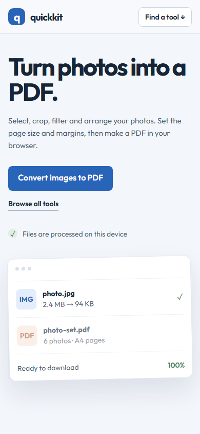
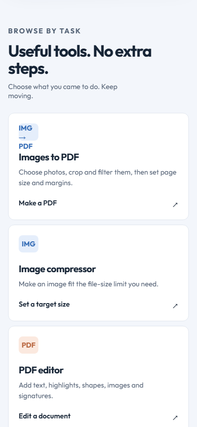
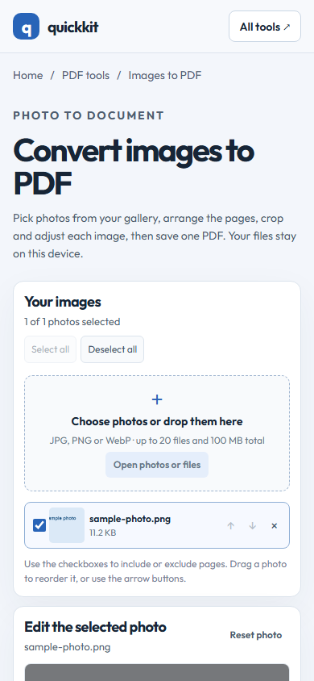
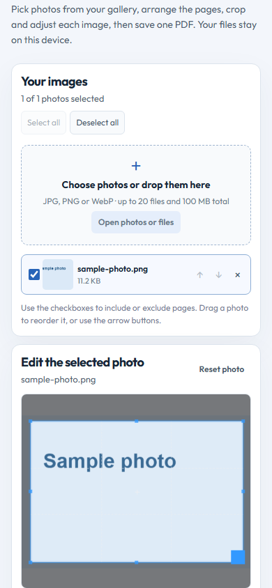
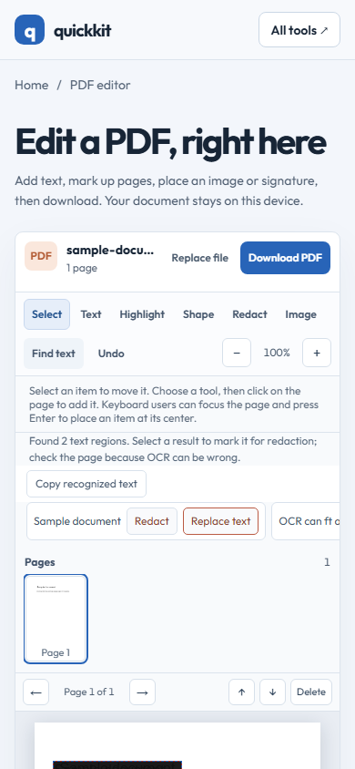
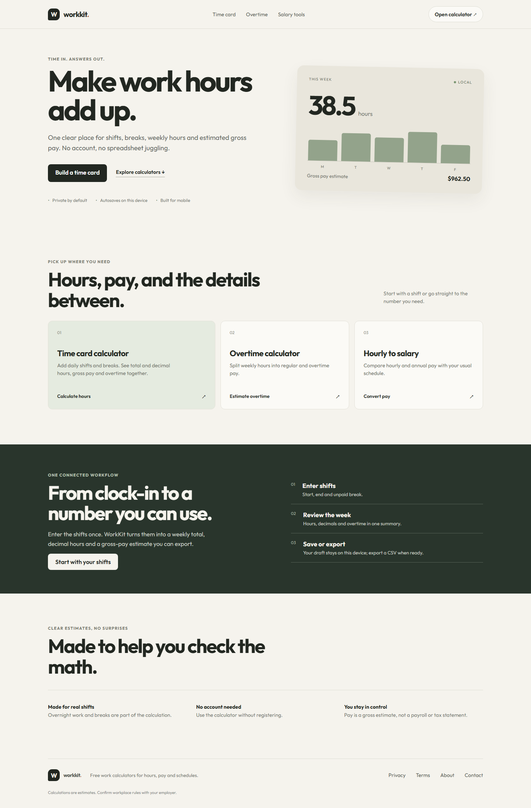
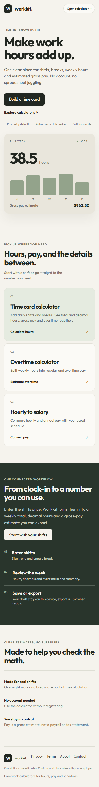
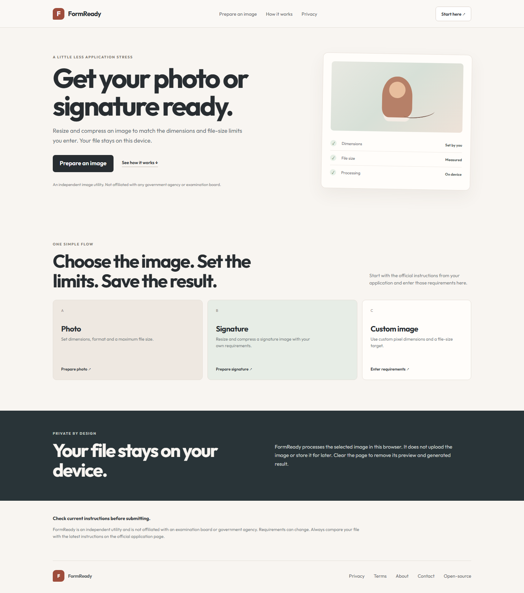
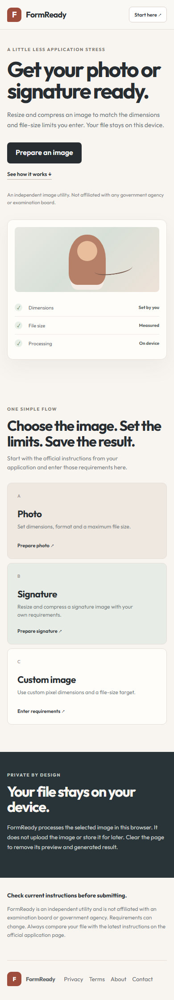

# LunarPanda Tools

Three focused browser tools for everyday work: edit PDFs, track hours, and prepare application photos. Each product is a separately built static website hosted on Cloudflare Pages.

## Live websites

| Product | What it does | Open |
|---|---|---|
| **QuickKit** | Photos to PDF, PDF annotations/OCR redaction, PDF merge, image compression, text tools and Wi-Fi QR codes | [quickkit-browser-tools.pages.dev](https://quickkit-browser-tools.pages.dev/) |
| **WorkKit** | Time cards, overnight shifts, breaks, overtime and hourly-to-salary estimates | [workkit-hours-tools.pages.dev](https://workkit-hours-tools.pages.dev/) |
| **FormReady** | Crop, resize, compress and measure a photo or signature for an application | [formready-photo-tools.pages.dev](https://formready-photo-tools.pages.dev/) |

## Product previews

### QuickKit

<p>Short mobile captures, shown as separate screen sections rather than one long page:</p>
<p><a href="https://quickkit-browser-tools.pages.dev/"></a> <a href="https://quickkit-browser-tools.pages.dev/#tools"></a> <a href="https://quickkit-browser-tools.pages.dev/image-to-pdf.html"></a></p>
<p><a href="https://quickkit-browser-tools.pages.dev/image-to-pdf.html"></a> <a href="https://quickkit-browser-tools.pages.dev/pdf-editor.html"></a></p>

### WorkKit

<p><a href="https://workkit-hours-tools.pages.dev/"></a></p>
<p><a href="https://workkit-hours-tools.pages.dev/"></a></p>

### FormReady

<p><a href="https://formready-photo-tools.pages.dev/"></a></p>
<p><a href="https://formready-photo-tools.pages.dev/"></a></p>

## Highlights

- Responsive pages checked at desktop, tablet and narrow phone sizes.
- QuickKit converts and arranges photos into PDFs, annotates PDF pages, and offers OCR-assisted text replacement/redaction that flattens affected pages on export.
- WorkKit validates shifts and avoids counting overlapping work twice; it saves drafts locally and exports CSV.
- FormReady measures the generated image dimensions and file size against requirements entered by the visitor.
- File processing happens in the browser; the tools do not upload visitors' files to an application server.
- Privacy, terms, about, contact and third-party acknowledgement pages are included for each product.

## Run locally

Requirements: Node.js 20 or newer and npm.

```bash
npm ci
npm run build
npm run dev:quickkit
```

The other development servers are `npm run dev:workkit` and `npm run dev:formready`. Product-specific builds are available as `npm run build:quickkit`, `npm run build:workkit` and `npm run build:formready`.

Each Vite build is configured in `products/<product>/vite.config.js` and writes to that product's `dist/` directory. QA scripts and recorded results are documented in [BROWSER_QA_CHECKLIST.md](BROWSER_QA_CHECKLIST.md).

## Hosting and search

The public sites use Cloudflare Pages `pages.dev` hostnames. No custom domain is currently connected. Google Search Console/Bing verification and search indexing are not represented as complete; indexing and rankings depend on search engines.

No Google ads are currently served. AdSense requires the site owner to connect an account, verify the site, and receive approval. A public README or code change does not activate advertising.

## Rights and third-party software

Original LunarPanda Tools source, product names, written content and visual design are proprietary. See [LICENSE](LICENSE). The public repository is viewable and may be forkable through GitHub; the notice does not technically prevent copying. Make the repository private if hiding the source is the priority.

Third-party dependencies retain their own terms. Product-specific notices are in each product's `public/THIRD-PARTY-NOTICES.txt`; the ClockMath helper attribution is in WorkKit's [open-source acknowledgements](https://workkit-hours-tools.pages.dev/open-source-acknowledgements.html).

## Project records

- [Implementation and release tracker](IMPLEMENTATION_TRACKER.md)
- [Browser QA checklist and evidence](BROWSER_QA_CHECKLIST.md)
- [Visibility and deployment checklist](VISIBILITY_AND_DEPLOYMENT_CHECKLIST.md)
- [Project backlog](PROJECT_TODO.md)
- [Hosting and domain plan](HOSTING_MIGRATION.md)
- [Search and AdSense setup plan](SEO_ADSENSE_PLAN.md)
