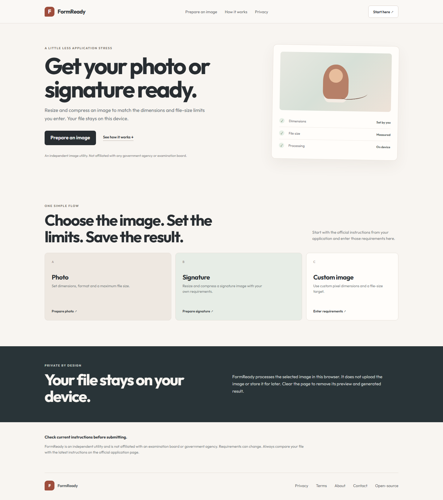
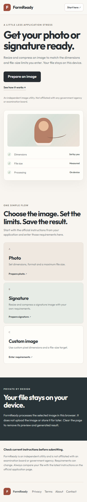
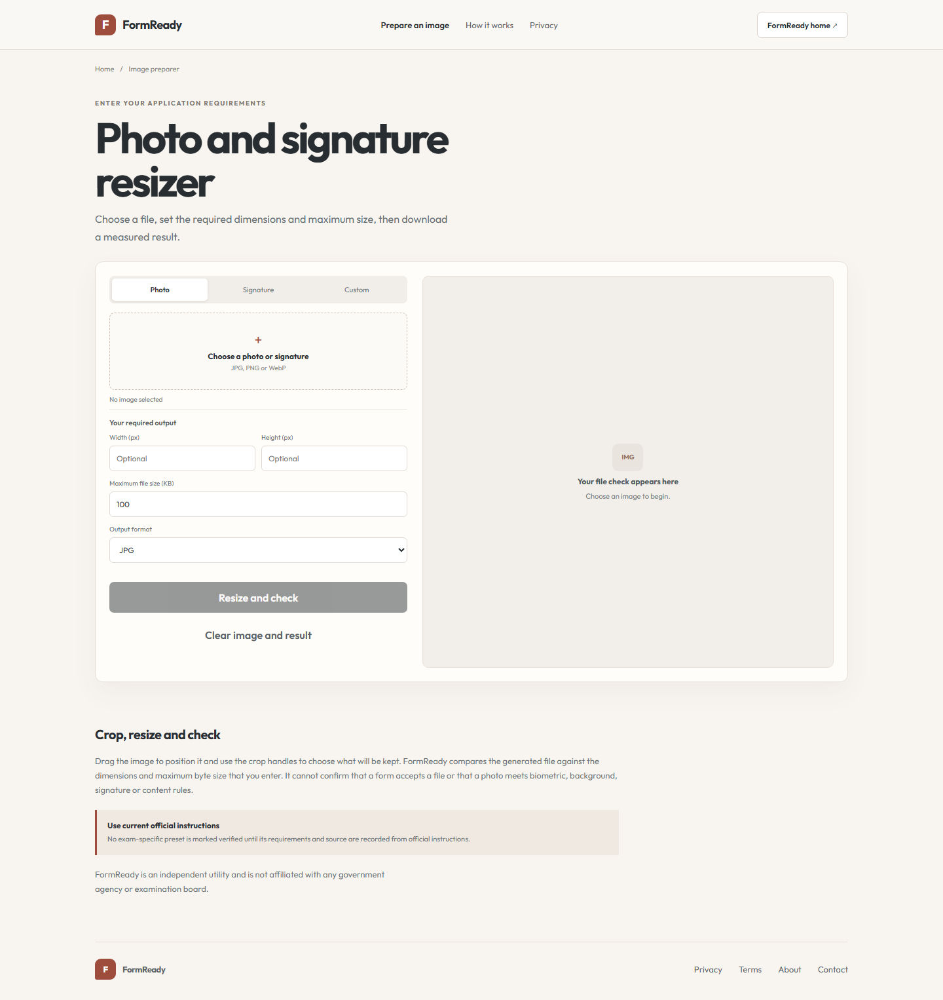
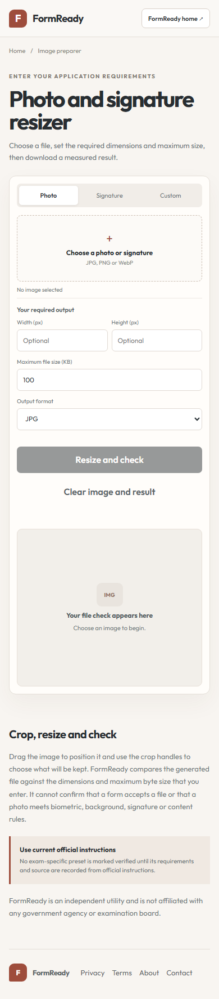

# FormReady

Prepare an application photo, signature or scan by cropping, resizing and checking its format, pixel dimensions and file-size range. Source-linked exam presets are labeled with their cycle; the current preset list contains historical cycles only.

**Live site:** https://formready-photo-tools.pages.dev/

## Screenshots

### Homepage

### Photo and signature preparer

## How it works

Choose an exam/document preset or enter the current requirements yourself. Crop, rotate, set dimensions and minimum/maximum file size, optionally clean a signature scan or add a name/date strip, then download the measured result. The checker distinguishes preferred dimensions from mandatory file checks. Image editing stays in the browser.

FormReady is an independent tool. It is not affiliated with a government agency, examination board or application portal. Some application photo steps require a live camera capture that this tool cannot perform. Presets cite their notice and cycle; always verify the latest rules. A measured file check does not guarantee that a portal will accept the image. Handwriting, face framing and signature quality need human review. See [the Exam Form Kit source audit](../../EXAM_FORM_KIT_PLAN.md).

## Development

From the workspace root, run `npm ci`, then `npm run dev:formready`. Build with `npm run build:formready`.

## Project and third-party notices

This product is proprietary; see the workspace [LICENSE](../../LICENSE). Dependencies retain their own terms, documented in `public/THIRD-PARTY-NOTICES.txt` and the live [open-source acknowledgements](https://formready-photo-tools.pages.dev/open-source-acknowledgements.html).
