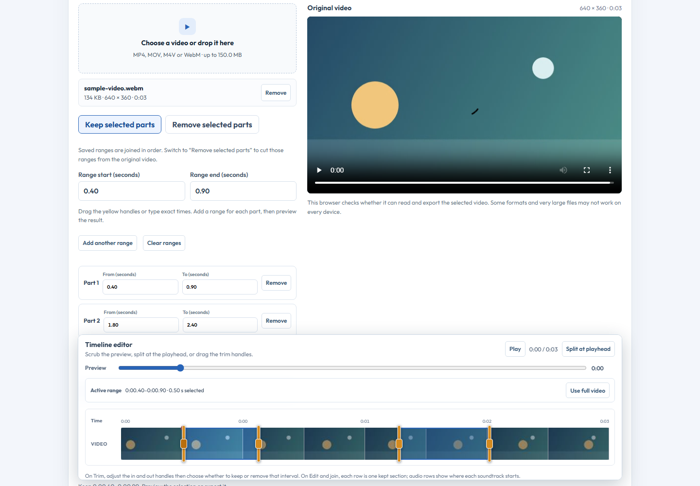
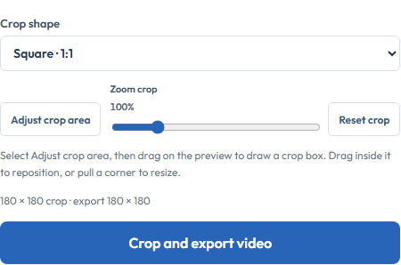

# QuickKit

Browser-based PDF, image, video, geo-tag photo, text, password and Wi-Fi QR tools.

**Live site:** https://quickkit-browser-tools.pages.dev/ 
**Images to PDF:** https://quickkit-browser-tools.pages.dev/image-to-pdf.html 
**PDF editor:** https://quickkit-browser-tools.pages.dev/pdf-editor.html
**Word and PDF converter:** https://quickkit-browser-tools.pages.dev/document-converter.html
**Video editor:** https://quickkit-browser-tools.pages.dev/video-tools.html 
**Geo-tag photo:** https://quickkit-browser-tools.pages.dev/geo-photo.html

## Screenshots

### Mobile previews, split into short sections

  

### Video and location tools, shown in short sections

 

## Tools

- Convert and order photos into PDFs; crop, rotate, filter, and set paper size/orientation/margins.
- Convert DOCX to a print-ready browser preview and extract selectable PDF text into editable DOCX files.
- Extract selectable text from every PDF page into a copyable view, TXT download or DOCX.
- Edit PDF pages with added text, highlights, rectangles, images and signatures; reorder/delete pages and export a new PDF.
- Replace or delete existing PDF text directly when a line meets the editor's supported structure and font rules. The editor preserves its source position and font and verifies the exported text before download.
- Use OCR to copy recognized text, redact a detected region, or start a masked text replacement with editable overlaid text.
- Run local English OCR to copy recognized text or mark OCR-detected regions for redaction. Redacted pages are flattened on export to remove their source text layer.
- Merge PDFs in the browser.
- Compress an image to a measured file-size target.
- Count and clean text; generate passwords.
- Create a Wi-Fi QR code.
- Compress and crop videos; save multiple non-overlapping ranges from one video, choose whether to keep or remove them, drag the range handles, preview the assembled output, join/reorder clips and add up to three positioned soundtracks on a bottom-docked timeline.
- Capture or choose a photo, search a named place on the map, tap or drag the pin to refine coordinates, and embed GPS in JPEG EXIF with device-local date/time and optionally print a nearby OpenStreetMap card with place, coordinates, time and visible attribution. Map-card tiles are requested only when the photo is created. Place search and nearby-name lookup contact OpenStreetMap only when you press their buttons.

Direct existing-text edits are intentionally limited to single-line, printable ASCII text in supported Standard Type 1/WinAnsi fonts, where the replacement fits the original width. Other fonts, complex scripts, reflow, encrypted/signed PDFs and unsupported layouts are refused; this is not universal font-perfect PDF editing. OCR replacement covers old text with a mask and overlays new text, so font and spacing are approximate and OCR can be wrong. Redacting a page flattens that page, removing its text layer and links and potentially changing visual quality. PDFs are processed on-device; OCR downloads its open-source engine and English model from a public CDN but does not upload the document. The PDF editor lazily downloads its qpdf WebAssembly engine when direct text editing is used.

DOCX-to-PDF rebuilds a print preview from document text and common formatting, then opens the browser print dialog; choose “Save as PDF.” Complex Word layout can change. PDF-to-DOCX keeps extracted text and page order when available but does not preserve page layout, images or tables. Scanned PDFs need OCR first. The converter limits input to 30 MB for DOCX, 100 MB and 200 pages for PDF. Image filters update the preview immediately and are baked into the photo when “Apply crop and filter” is pressed. Video export re-encodes and can change quality; soundtrack mixes are capped at four minutes on desktop and two minutes on narrow screens. The current video workspace does not download videos from social platforms or extract a standalone audio file. Geo-tagged JPEGs contain exact GPS metadata; check it before sharing.

## Development

From the workspace root, run `npm ci`, then `npm run dev:quickkit`. Build with `npm run build:quickkit`. Run `npm run qa:pdf-editor`, `npm run qa:quickkit-documents`, `npm run qa:video-tools`, `npm run qa:video-trim-ranges` and `npm run qa:geo-photo` (set `HEADED=1` to observe Chromium). `npm run qa:geo-photo-live-map` checks real OpenStreetMap tiles on desktop and mobile without submitting coordinates or place queries.

## Project and third-party notices

This product is proprietary; see the workspace [LICENSE](../../LICENSE). Dependencies and selected upstream components retain their own licenses. See `public/THIRD-PARTY-NOTICES.txt` and the live [open-source acknowledgements](https://quickkit-browser-tools.pages.dev/open-source-acknowledgements.html).
