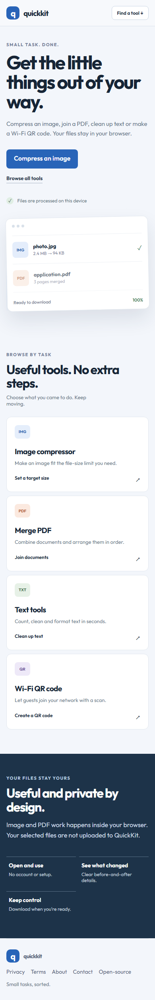
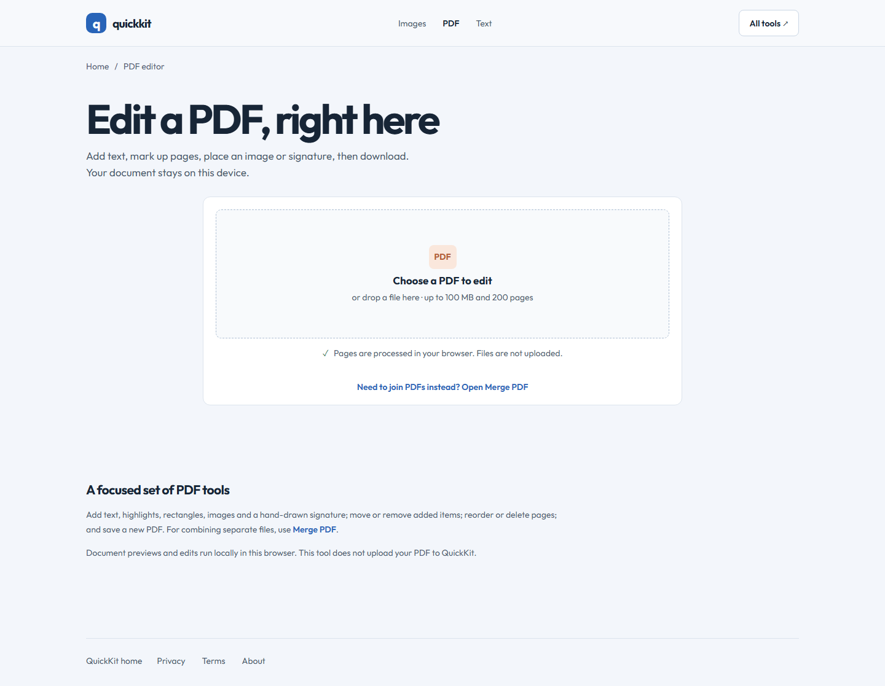
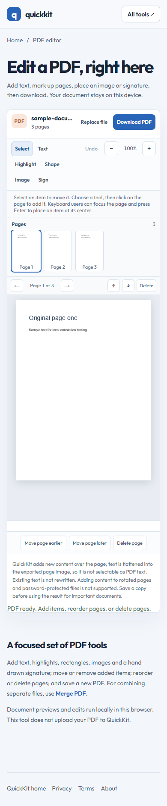

# QuickKit

Browser-based PDF, image, text, password and Wi-Fi QR tools.

**Live site:** https://quickkit-browser-tools.pages.dev/ 
**PDF editor:** https://quickkit-browser-tools.pages.dev/pdf-editor.html

## Screenshots

### Homepage

### PDF editor

## Tools

- Edit PDF pages with text, highlights, rectangles, images and signatures; reorder/delete pages and export a new PDF.
- Merge PDFs in the browser.
- Compress an image to a measured file-size target.
- Count and clean text; generate passwords.
- Create a Wi-Fi QR code.

PDF editing is annotation-based; it does not rewrite arbitrary existing PDF text. Password-protected files are not supported. Files are processed locally in the browser and are not sent to a QuickKit application server.

## Development

From the workspace root, run `npm ci`, then `npm run dev:quickkit`. Build with `npm run build:quickkit`. The PDF editor smoke workflow is `npm run qa:pdf-editor`.

## Project and third-party notices

This product is proprietary; see the workspace [LICENSE](../../LICENSE). Dependencies and selected upstream components retain their own licenses. See `public/THIRD-PARTY-NOTICES.txt` and the live [open-source acknowledgements](https://quickkit-browser-tools.pages.dev/open-source-acknowledgements.html).
