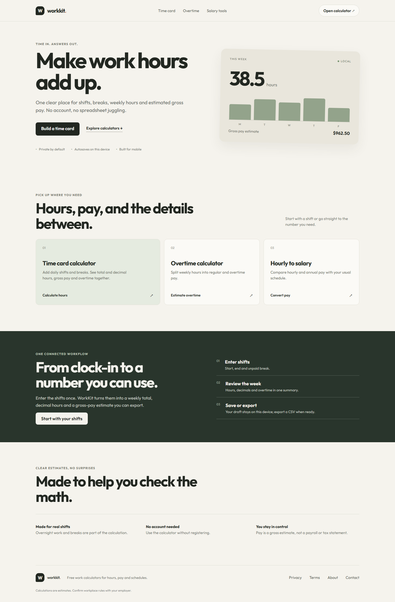
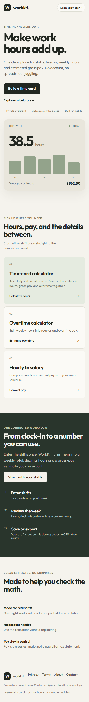
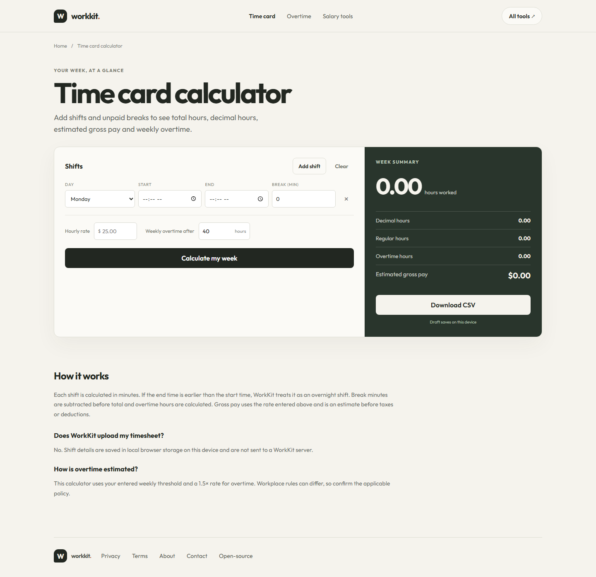
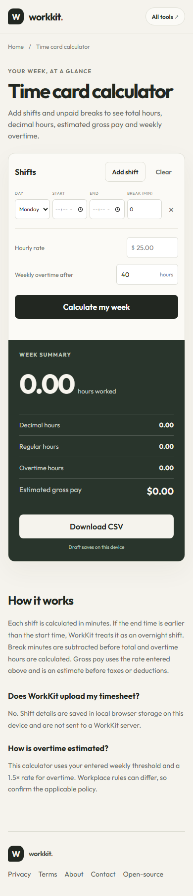

# WorkKit

Free time-card, work-hours, overtime and salary-estimate calculators.

**Live site:** https://workkit-hours-tools.pages.dev/

## Screenshots

### Homepage

### Time-card calculator

## Tools

- Weekly time cards with shifts, unpaid breaks, overnight work and hours/minutes totals.
- Overtime and estimated gross pay calculation.
- Hourly-to-salary comparison.
- Local draft storage, CSV export and print/save as PDF.
- Currency formatting for USD, INR, GBP, EUR, CAD, AUD and AED. Currency selection formats the amount; it does not convert exchange rates.

WorkKit provides estimates and is not payroll, tax, legal or financial advice. Shift values stay in the browser; they are not sent to a WorkKit application server.

## Development

From the workspace root, run `npm ci`, then `npm run dev:workkit`. Build with `npm run build:workkit`.

## Project and third-party notices

This product is proprietary; see the workspace [LICENSE](../../LICENSE). The time helper adapts selected ClockMath functions under MIT; attribution and terms are on the live [open-source acknowledgements](https://workkit-hours-tools.pages.dev/open-source-acknowledgements.html) and in `public/THIRD-PARTY-NOTICES.txt`.
